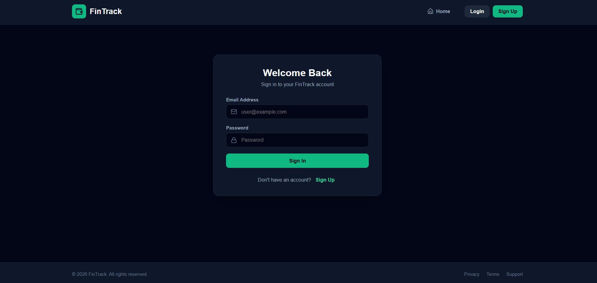
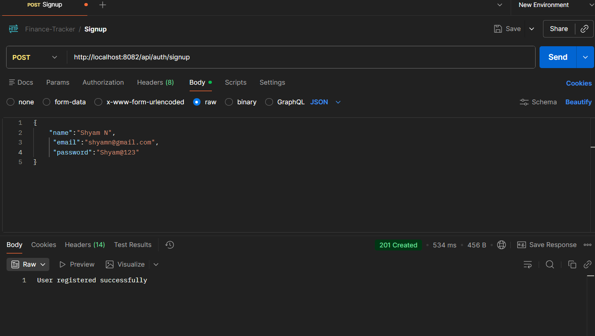

# 📊 FinTrack - Expense Tracker REST API

FinTrack is a secure expense tracker backend built with **Java, Spring Boot, Spring Security and MySQL**. It provides REST APIs to manage users, income and expense categories, and transactions, with JWT authentication.

---

## 🚀 Features

* **Secure Authentication:** User signup and login with JWT (JSON Web Tokens) and BCrypt password encryption.
* **Category Management:** Create, view, update, and delete custom income/expense categories.
* **Transaction Tracking:** Add, update, view, and delete user-specific transactions.
* **Financial Summary:** Total income, total expenses, and current balance.
* **Robust Backend:** Spring Data JPA/Hibernate for persistence, strict input validation, and a layered REST architecture.

---

## 📸 API Testing (Postman)

### Login (JWT response)


### Login (JWT response)



### Create Transaction


### Get Transactions


---

## 🛠️ Tech Stack

* Java 17 & Spring Boot
* Spring Security (JWT, BCrypt)
* Spring Data JPA & Hibernate
* MySQL
* Apache Maven
* Postman (API testing)
* IntelliJ IDEA, Git & GitHub

---

## 📐 Architecture & Database

### System Flow
```text
Client ➔ REST APIs ➔ Controller ➔ Service ➔ Repository ➔ JPA/Hibernate ➔ MySQL
```

### Data Model
```text
User (1) ─── (N) Transaction (N) ─── (1) Category
```

* **User:** `id` (PK), `name`, `email`, `password`
* **Category:** `id` (PK), `name`, `description`
* **Transaction:** `id` (PK), `amount`, `type` (INCOME/EXPENSE), `description`, `transactionDate`, `userId` (FK), `categoryId` (FK)

---

## 🌐 API Endpoints

### 🔐 Authentication & Users

| Method | Endpoint | Description |
| :--- | :--- | :--- |
| POST | `/api/auth/signup` | Register a new user |
| POST | `/api/auth/login` | Authenticate user & return JWT token |
| GET | `/api/users/profile` | Get logged-in user profile |

### 🏷️ Categories

| Method | Endpoint | Description |
| :--- | :--- | :--- |
| GET | `/api/categories` | Get all categories |
| POST | `/api/categories` | Create a new category |
| PUT | `/api/categories/{id}` | Update an existing category |
| DELETE | `/api/categories/{id}` | Delete a category |

### 💳 Transactions

| Method | Endpoint | Description |
| :--- | :--- | :--- |
| GET | `/api/transactions` | Get all transactions for the authenticated user |
| GET | `/api/transactions/{id}` | Get specific transaction details |
| POST | `/api/transactions` | Create a new transaction |
| PUT | `/api/transactions/{id}` | Update a transaction |
| DELETE | `/api/transactions/{id}` | Delete a transaction |

#### Example Request Body (`POST /api/transactions`)
```json
{
  "userId": 1,
  "categoryId": 1,
  "amount": 250.00,
  "type": "EXPENSE",
  "description": "Lunch",
  "transactionDate": "2026-09-04"
}
```

Protected endpoints need the header `Authorization: Bearer <token>`.

---

## 💻 Run Locally

### 1. Prerequisites
* JDK 17 or higher
* Maven
* MySQL Server

### 2. Database Setup
```sql
CREATE DATABASE fintrack;
```
Update `finance-backend/src/main/resources/application.properties`:
```properties
spring.datasource.url=jdbc:mysql://localhost:3306/fintrack
spring.datasource.username=YOUR_MYSQL_USERNAME
spring.datasource.password=YOUR_MYSQL_PASSWORD
```

### 3. Start the Application
```bash
cd finance-backend
mvn spring-boot:run
```
Base URL: `http://localhost:8082`

Test the APIs with Postman: sign up, log in, then send the JWT as a Bearer token.

---

## 👤 Author

**Vutla Dhanush**
🎓 B.Tech – Computer Science and Engineering, KL University
🌐 [GitHub Profile](https://github.com/vutladhanush)
